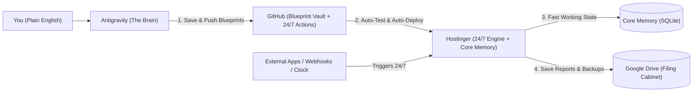

# Antigravity Flow — Generation 1

An n8n-style personal automation system built around 4 simple roles:

1. **You + Antigravity (The Brain):** You tell Antigravity what you want automated. Antigravity plans the steps, builds/edits the workflow blueprint, tests it, and pushes it.
2. **GitHub (The Blueprint Vault & Courier):** Stores every workflow blueprint safely in [`workflows/`](workflows/), runs automated tests, executes scheduled GitHub jobs 24/7, and ships updates straight to Hostinger.
3. **Hostinger (Core Memory & 24/7 Engine):** Stays awake day and night running schedules and webhooks, holding fast working memory (SQLite database: counters, state, queues, run logs).
4. **Google Drive (The Filing Cabinet):** Stores heavy files, generated reports, documents, and automatic snapshots of Core Memory.



---

## Run & Test Locally (Zero External Dependencies)

Requires **Node.js 22.13+** (tested on Node 24 using built-in `node:sqlite`).

```bash
# Validate all workflow blueprints
npm run validate

# Run full end-to-end test suite
npm test

# Start the Gen-1 Studio + 24/7 Engine + API server
npm start
```

Out of the box (without configuring `.env`), Storage Drive runs in **`local-sandbox`** mode (`./data/drive/`) so you can test every single workflow immediately.

---

## Included Gen-1 Starter Workflows

| Workflow | Trigger | What It Tests |
|---|---|---|
| [`wf-core-heartbeat-backup`](workflows/wf-core-heartbeat-backup.json) | Cron (every 6h) or Manual | **Hostinger Core Memory -> Google Drive:** Increments counter, snapshots all Core Memory, uploads backup JSON to Drive, writes receipt back to Core Memory. |
| [`wf-webhook-intake-router`](workflows/wf-webhook-intake-router.json) | Live HTTP Webhook | **Smart Branching:** Logs event in Core Memory; if `priority === "high"`, Brain writes a Markdown brief and archives it in Google Drive; otherwise queues it lightly in Core Memory. |
| [`wf-github-repo-pulse`](workflows/wf-github-repo-pulse.json) | Daily Cron (Hostinger or GitHub Actions) | **24/7 GitHub Automation:** Fetches latest commits/issues, writes a daily digest, updates Core Memory, and saves `reports/github-pulse-latest.md` to Drive. |

---

## Switching from Test Sandbox to Live Production

### 1. Connect Live Google Drive
Copy `.env.example` to `.env` and add either:
- **Google Service Account** (recommended for 24/7 servers): `GOOGLE_SERVICE_ACCOUNT_JSON` (or `GOOGLE_SERVICE_ACCOUNT_PATH`) + `GOOGLE_DRIVE_FOLDER_ID`
- **OAuth2 Refresh Token**: `GOOGLE_CLIENT_ID`, `GOOGLE_CLIENT_SECRET`, `GOOGLE_REFRESH_TOKEN`, `GOOGLE_DRIVE_FOLDER_ID`

The engine automatically switches from `local-sandbox` to `google-drive-live`.

### 2. Deploy 24/7 on Hostinger VPS
```bash
docker compose up -d --build
```
Or add `HOSTINGER_HOST`, `HOSTINGER_USER`, and `HOSTINGER_SSH_KEY` as GitHub Repository Secrets so pushing to `main` auto-deploys via [`.github/workflows/deploy-hostinger.yml`](.github/workflows/deploy-hostinger.yml).

### 3. Control Remotely via Brain CLI
```bash
ANTIGRAVITY_REMOTE_URL=https://your-hostinger-domain.com \
ANTIGRAVITY_API_KEY=your-secret \
node src/cli.mjs status
```
